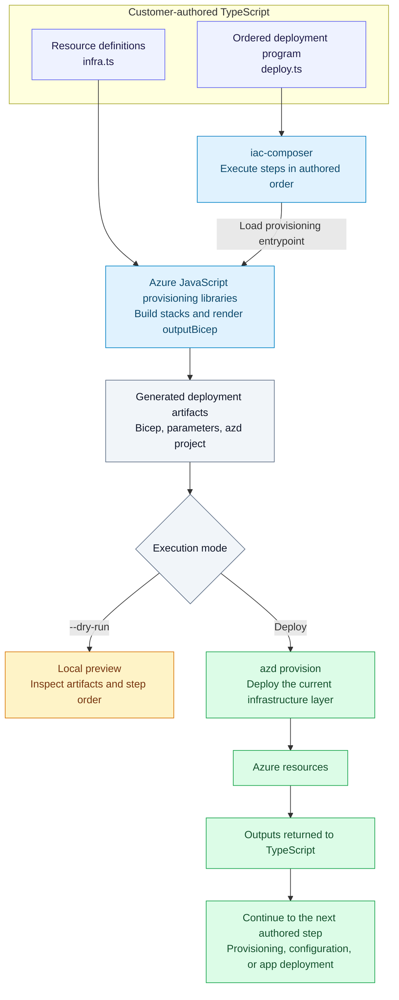

# iac-composer

**Azure Infrastructure as Code in TypeScript.**

`iac-composer` lets customers define their own Azure infrastructure as code in
TypeScript, using the
[Azure JavaScript provisioning libraries](https://github.com/Azure/js-provisioning-lib).
You own the resource definitions, configuration, dependencies, and deployment
order. Use familiar TypeScript functions, modules, and reusable components to
build infrastructure that fits your application.

The provisioning libraries model Azure resources and render them to Bicep.
`iac-composer` loads your provisioning entrypoints, prepares the deployment
artifacts, provisions resources, and returns outputs for subsequent steps.
JavaScript entrypoints are also supported.

## How it works

1. **Define resources in TypeScript.** Build stacks with the JavaScript
   provisioning libraries and the resource-specific `@azure/provisioning-*`
   packages your infrastructure needs.
2. **Expose provisioning output.** Render the stack to Bicep and export
   `outputBicep`, or provide a custom compiler and its artifact directory.
3. **Compose your deployment.** Write a TypeScript program that provisions
   stacks in your chosen order and passes outputs to dependent steps.
4. **Preview and deploy.** Use `--dry-run` to compile and inspect local artifacts,
   then execute the same program to deploy to Azure.

Under the hood, `iac-composer` prepares azd projects from your provisioning output and
delegates resource deployment to `azd provision`. Node.js 20.6 or newer is
required; Azure deployment also requires azd, Azure CLI, and authenticated access.



The compilation path is shared by dry runs and real deployments. A dry run stops
at local artifacts; a real deployment returns outputs and continues through your
program in order.

## Compose an infrastructure deployment

```ts
import { defineDeployment, requiredEnv } from "iac-composer";

export default defineDeployment(async (deployment) => {
  const outputs = await deployment.provision("infrastructure", {
    entrypoint: "./infra.ts",
    outputDirectory: ".generated/infrastructure",
    scope: "resourceGroup",
    resourceGroup: requiredEnv("AZURE_RESOURCE_GROUP"),
    subscription: requiredEnv("AZURE_SUBSCRIPTION_ID"),
    location: requiredEnv("AZURE_LOCATION"),
  });

  await deployment.env("publish infrastructure outputs", outputs);
});
```

Here, `infra.ts` contains your resource definitions built with the provisioning
libraries. For a complete example, see the chatbot's
[TypeScript provisioning stack](examples/chatbot/src/components/shared/provisioning.ts)
and [deployment program](examples/chatbot/src/deploy.ts).

When needed, add application deployment or configuration actions with
`deployment.deploy` after their infrastructure prerequisites. `AzdProject`
supports `azd deploy` service targets while your TypeScript program retains
lifecycle ordering.

## Agent skill

The [iac-composer skill](.github/skills/iac-composer/SKILL.md) covers direct IaC
composition, output wiring, dry runs, and ordered deployment execution.
Install it with GitHub CLI 2.90.0 or newer:

```bash
gh skill preview qiaozha/iac-compose iac-composer --allow-hidden-dirs
gh skill install qiaozha/iac-compose iac-composer --allow-hidden-dirs
```

## Commands

```bash
npm install
npm run build
npm run iac-composer -- ./deployment.ts --environment dev
npm run iac-composer -- ./deployment.ts --environment dev --dry-run
```

## Deployment lifecycle

Run authored programs with `iac-composer ./deployment.ts --environment dev`.

`--dry-run` renders provisioning entrypoints and writes their generated Bicep,
parameter files, and one `.generated/azure.yaml` as a local-only preview.
Real deployments initialize the azd environment and execute cloud and application
steps in authored order.
Each provisioning component is a named Bicep layer whose files remain under
`.generated/<component>/`. `iac-composer` preserves authored lifecycle ordering by
running `azd provision <layer>` at each provisioning step. Infrastructure layers
and deployable services share the single `.generated/.azure` environment.
Generated runtime paths expose one `generated<Component>Layer` descriptor, so a
component passes only `layer` to `deployment.provision`. The descriptor derives
the standard `components/<component>/provisioning.ts` entrypoint and
`.generated/<component>` output directory from the component name. The two-phase
Entra lifecycle uses bootstrap and configuration descriptors that share the same
`identity` output layer but override the source entrypoint.
`getAzdProject` shares one `AzdProject` per deployment, generated root, and
environment for environment state, infrastructure layers, and service manifests.

Delete all resources tracked by that generated project with:

```bash
iac-composer down ./package/deployment/.generated --environment dev --force
```

Cleanup requires an explicit environment, `--force`, and iac-composer ownership
metadata in `azure.yaml`. Add
`--purge` to permanently remove resources that Azure otherwise soft-deletes.

`-C <directory>` changes the deployment working directory. A program can use
`deployment.inDirectory(...)` for a scoped child context.

`--component <name>` passes a deployment-defined component selector to the
program. Programs that support component selection can use it to run one
component while keeping their default full deployment unchanged.

## Provisioning libraries

Infrastructure definitions use the Azure JavaScript provisioning libraries:

- `@azure/provisioning-core` provides stacks, parameters, outputs, and expressions.
- Resource-specific packages such as `@azure/provisioning-storage` and
  `@azure/provisioning-appservice` provide Azure resource definitions.
- `@azure/provisioning-serialization` and `@azure/provisioning-bicep` serialize
  stacks and render deployment artifacts.

Install the provisioning packages your code imports in your own project. Keep
the TypeScript definitions as the source of truth; Bicep and parameter files
are build artifacts.

A provisioning entrypoint must export a non-empty `outputBicep` array of
`{ path, contents }` objects when passed through `entrypoint`. Libraries that
require their own build process can instead provide a compiler command and its
artifact directory:

```ts
await deployment.provision("resources", {
  compiler: { command: "pnpm", args: ["run", "compile"] },
  artifactsDirectory: "generated/bicep",
  outputDirectory: ".generated/resources",
  location: process.env.AZURE_LOCATION,
});
```

The runtime records all layered artifact paths in the single
`.generated/.iac-composer-generated.json` manifest and only replaces files under
the layer being regenerated. Existing per-layer manifests are migrated into
that root manifest. Standalone provisioning keeps its manifest in its output
directory. Layered provisioning merges a JSON-compatible
`.generated/azure.yaml`, synchronizes its shared azd environment, runs
`azd provision <layer>`, and returns azd environment outputs as strings. For an
`outputDirectory` directly under `.generated`, the runtime infers the layer name
from the directory name and `dependsOn` from the order in which provisioning
calls first appear. Other output directories retain a standalone azd project.

## Chatbot integration

The chatbot is its own npm package. Its provisioning dependencies are pinned to
package-specific GitHub release assets from
`Azure/js-provisioning-lib` in `examples/chatbot/package.json`.
Install them with:

```bash
npm ci --prefix examples/chatbot
```

The chatbot consumes this tool through the relative
`iac-composer: file:../..` package dependency and imports its public API.

[examples/chatbot/src/deploy.ts](examples/chatbot/src/deploy.ts) is the centralized
business-order program:

```ts
await shared(deployment);
await agent(deployment);
await agentServer(deployment);
await functionApp(deployment);
await frontend(deployment);
await logicApp(deployment);
await knowledgeSync(deployment);
```

All implementation is grouped under
[examples/chatbot/src](examples/chatbot/src):

- `components/shared/` owns the resource group, shared storage, identity,
  registry, configuration, Search, Cosmos DB, Key Vault, and Graph application.
- `components/agent/`, `components/frontend/`, `components/agent-server/`, and
  `components/function-app/` each own a colocated provisioning stack and run it
  immediately before that component's configuration and deployment.
- `components/agent/` owns the bot managed identity and deploys the hosted
  Foundry agent through a generated `azure.ai.agent` service, reading status
  through `azd ai agent show`.
- Application containers are built, published, and deployed by source-backed
  `azd deploy <service>` targets; component code supplies its source, Docker
  configuration, target resource, and settings.
- `components/logic-app/` waits for the Function host and then provisions its integration
  account, connections, complete workflow, identities, and alert from the typed
  TypeScript stack colocated in `provisioning.ts`. Its Teams tenant, group, and channel IDs are selected
  from the component-local `config/<environment>.json` profile. Refresh the
  `dev`, `preview`, and `prod` profiles from the sibling `sdk-ai-bots`
  environment suite with:

  ```bash
  npm --prefix examples/chatbot run sync:logic-app-config
  ```
- `components/knowledge-sync/` owns Search bootstrap through the official Azure
  SDK and runs the application-owned synchronization process.
- `runtime/` contains chatbot-specific environment composition and paths.
  Azure CLI execution, retries, readiness checks, azd App Service and Function
  deployment, RBAC, resource-group creation, account lookup, and environment-file
  primitives are exported by `iac-composer` itself.

The [Contoso agent component](examples/contoso/components/agent/index.ts) owns its
hosted-agent lifecycle, provisioning layer, and runtime configuration. Service
workflows for the agent, Teams application, and Logic App live under
[runtime/services/](examples/contoso/runtime/services).

Deployment outputs and lifecycle values are stored in the shared azd environment
under `examples/chatbot/.generated/.azure/`. Non-secret environment inputs live
in `examples/chatbot/src/environments/<environment>.json`.

Prerequisites for a real deployment are Node.js 20.6+, `azd` 1.30.0+, `az`, `pnpm`,
`npm`, authenticated azd and Azure CLI sessions, and Microsoft 365 access for
Teams app registration. The deploying identity also needs Microsoft Graph application and
app-role-assignment permissions for the Graph Bicep resources. Tenants that
enforce Service Tree ownership for app registrations require a service management
reference; manually authored deployments must supply their own reference.

Knowledge synchronization additionally requires:

- `AZURE_SDK_DOCS_PATH` and `AZURE_SDK_WIKI_PATH` pointing to the two internal
  repository checkouts;
- `AZURE_SDK_GITHUB_PAT` in the shell for token-authenticated GitHub sources;
- a base64-encoded `SSH-PRIVATE-KEY` secret in the provisioned Key Vault.

On a new environment, the first run provisions the Teams API connection and
then stops with its Azure portal consent URL. The same component provisioning
program runs with the workflow condition disabled for this bootstrap. Authorize
the connection and rerun; the next component provision includes the complete
workflow, and completed lifecycle functions are idempotent.

```bash
npm run iac-composer -- examples/chatbot/src/deploy.ts -e dev --dry-run
npm run iac-composer -- examples/chatbot/src/deploy.ts -e dev
npm run iac-composer -- examples/chatbot/src/deploy.ts -e dev --component logic-app
npm run iac-composer -- down examples/chatbot/.generated -e dev --force
```

The chatbot component names are `shared`, `agent`, `agent-server`,
`function-app`, `frontend`, and `logic-app`.